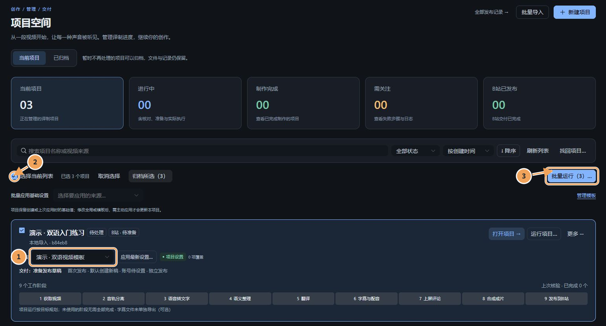
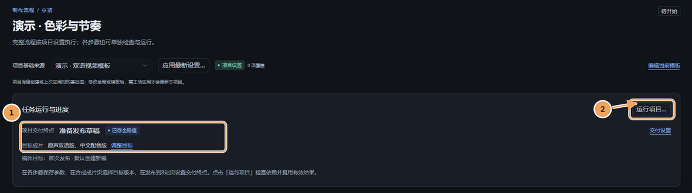
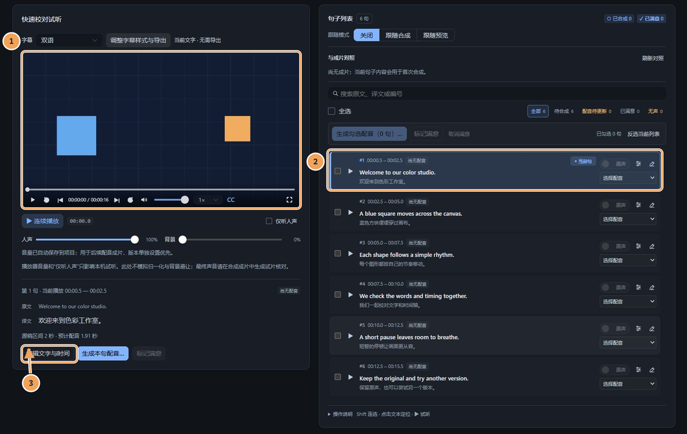
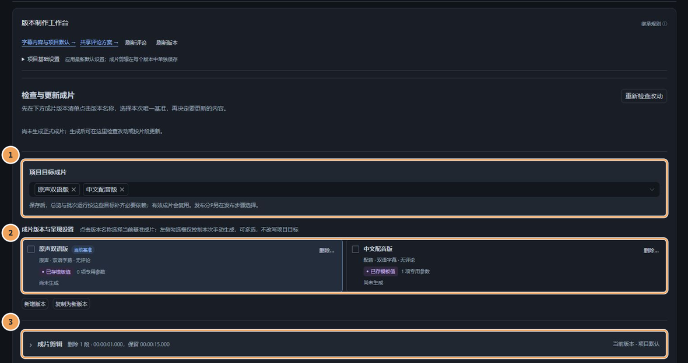
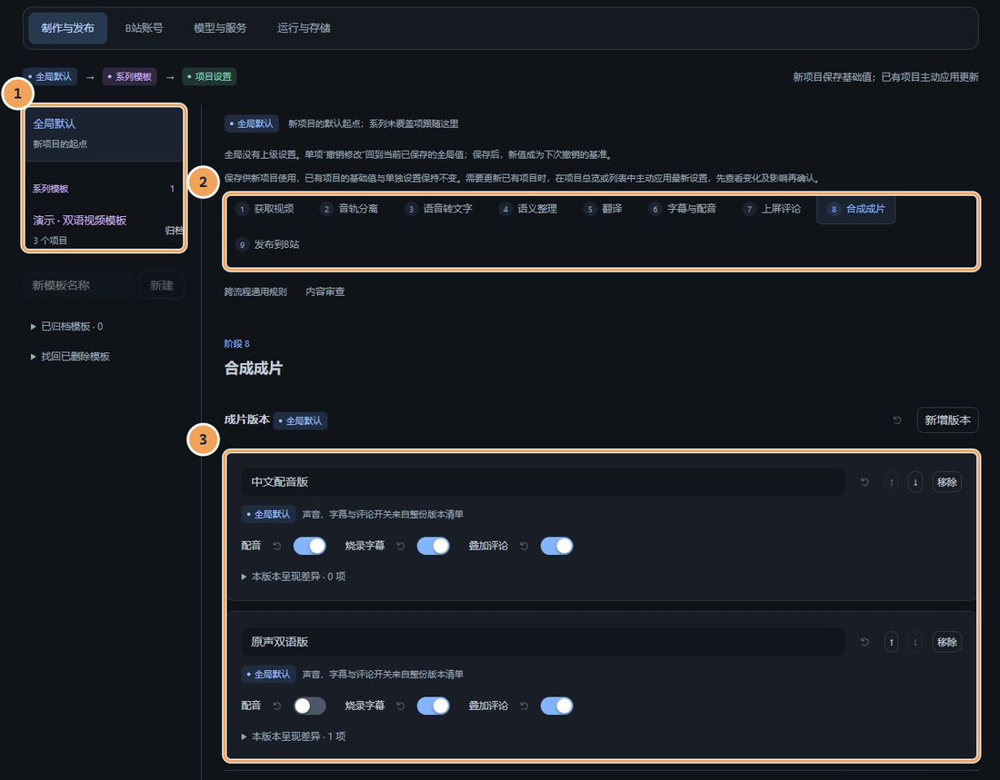

# DubForge

**在本地完成视频翻译、字幕校对、配音与多版本成片。**

DubForge 是独立开发的视频译制工作台。输入视频链接或本地文件，按需要完成识别、语义整理、翻译、逐句配音、字幕烧录和剪辑；也可以套用模板批量制作，并将选定成片作为多个分 P 投稿到 B 站。

你可以让它按已确认的目标自动推进，也可以随时回到某一句、某个步骤或某个成片版本检查和调整。中断后保留有效结果，继续前先检查依赖、输入和平台回执。

**v1.0.0 · 首个正式版本 · Windows 源码发行**

[开始使用](#快速开始) · [安装与模型](docs/installation.md) · [全部文档](docs/README.md) · [版本记录](CHANGELOG.md) · [下载发行版](https://github.com/heroliss/dubforge/releases/latest)

当前仓库为私有仓库，访问源码和发行版需要已有仓库权限。

*项目空间：①指定模板，②选择项目，③检查本次计划后批量运行。文档截图均使用隔离的演示项目，不含真实账号、密钥或私有作品。*

## 可以做什么

- **字幕与配音共用一份校对稿。** 对照视频修改原文、译文和时间，逐句试听、切换原声或配音、保留声音版本；修改译文后只更新受影响的声音。
- **先试少量，再制作整片。** 支持试配、试片、字幕样式帧预览和声音报告；时间排布、句间音量与最终响度都有可检查的结果。
- **一条视频，多个成片版本。** 原声/配音、字幕和上屏评论可组合；版本设置、删除片段清单和输出分别管理，章节时间随剪辑后的时间轴同步处理。
- **模板让批量制作可复用。** 全局默认、系列模板、项目及本句设置各有明确作用范围；已开始的任务使用冻结快照，后续修改不会悄悄改变正在执行的工作。
- **失败可以定位，恢复有依据。** 步骤产物绑定输入指纹；后台记录进度、错误和请求身份，避免重复执行。文件存在不等于完成，任务结束后还会核验产物。
- **可选 B 站交付。** 支持多分 P 顺序、合集分组、保留 BV 更新原稿、文案和章节同步。上传、审核和章节状态分别显示；未知回执先核对，审核退回保留具体原因。

自动化范围由你确认的项目目标决定。模型服务、素材权限和平台审核由对应服务及平台处理；程序会显示结果、保留断点，不把“已上传”显示成“已公开发布”。

## 技术路线

~~~text
获取视频 → 音轨分离 → 语音转文字 → 语义整理 → 翻译
                                           ↓
发布到 B 站 ← 合成成片 ← 上屏评论 ← 字幕与配音
~~~

九个阶段共用项目、依赖和执行状态。只做字幕时可以跳过配音和投稿；本地文件、平台字幕及不同制作目标按实际依赖生成计划。

| 环节 | 当前方案 |
| --- | --- |
| 界面 | Vue 3、TypeScript、Naive UI、Pinia；浏览器访问本地工作台 |
| 应用与状态 | Python 3.13、FastAPI、SQLModel/SQLite；领域逻辑独立于 HTTP 层 |
| 视频与字幕 | yt-dlp 获取素材，FFmpeg/FFprobe 处理音轨、字幕、评论和成片 |
| 识别与音轨分离 | faster-whisper、可选 Demucs；按需安装和下载模型 |
| 语义与翻译 | OpenAI 兼容 LLM，可配置模型服务及故障回退 |
| 语音合成 | 独立连接 IndexTTS 2.5 或 GPT-SoVITS；模型环境与主程序分开 |
| B 站连接 | 独立 Node.js 工作者，使用 @renmu/bili-api；账号与回执由本机保存 |
| 恢复与复用 | 原子写入、输入指纹、冻结快照、后台任务与持久回执 |

详细模块边界和数据流见[架构说明](docs/architecture.md)。

## 快速开始

### 1. 准备环境并安装

当前正式验证平台为 **Windows**，建议使用 **Node.js 24 LTS**。先安装 [Git](https://git-scm.com/downloads)、[uv](https://docs.astral.sh/uv/getting-started/installation/)、[Node.js](https://nodejs.org/) 和 [FFmpeg](https://ffmpeg.org/download.html)，确认 ffmpeg、ffprobe 可在终端中运行。uv 会按项目要求准备 Python 3.13。

在 PowerShell 中执行：

~~~powershell
git clone https://github.com/heroliss/dubforge.git
cd dubforge
git checkout v1.0.0
powershell -NoProfile -ExecutionPolicy Bypass -File .\scripts\install.ps1 -Asr -Separation -Publishing
~~~

下载 Release 源码压缩包的用户，解压后在项目目录执行最后一行即可。

安装脚本会准备所选依赖、构建网页，并在缺少配置时复制示例；不会覆盖已有配置。识别、音轨分离和 B 站组件分别由 -Asr、-Separation、-Publishing 选择；仅安装基础程序可以不带这些选项。首次使用模型时可能还需下载权重。

**配音服务需单独安装。** IndexTTS / GPT-SoVITS 的环境、模型和参考音频按各自官方说明准备，再在 DubForge 中填写地址。完整步骤、GPU 与缓存设置见[安装指南](docs/installation.md)。

### 2. 启动工作台

安装完成后，在项目目录运行：

~~~powershell
uv run --project backend --no-sync uvicorn app.main:app --host 127.0.0.1 --port 8600 --loop app.event_loop:create_event_loop
~~~

浏览器打开 [http://127.0.0.1:8600](http://127.0.0.1:8600/)。该方式由同一后端托管已构建的网页。

开发或需要统一控制台时，可运行 **StartDev.bat**；它按配置启动后端、启动 Vite，并提供状态、日志与重启操作。默认前端地址为 [http://127.0.0.1:5273](http://127.0.0.1:5273/)。更换端口及开发命令见[开发指南](docs/development.md)。

### 3. 配置服务，先做一段短片

1. 在“设置 → 模型与服务”连接 LLM，检查识别和配音服务；首次先确认所选能力可以运行。
2. 在“制作与发布”保存全局默认或系列模板。新项目会保存当时的基础值，修改模板后可主动检查差异并应用。
3. 创建项目，输入视频链接或本地路径，指定模板；先查看项目总览中的目标和依赖，再确认运行。
4. 到“字幕与配音”校对少量句子并试听，确认翻译、音色和时间；满意后补齐所需声音。
5. 到“合成成片”配置版本、字幕、评论和删除片段，先生成短试片，再制作正式版本。
6. 需要投稿时，在“发布到 B 站”设置账号、分 P、文案和合集，检查计划并确认。新项目默认准备新稿；已有发布记录时需要明确选择新稿或原稿。

*①核对交付终点与目标成片，②检查依赖并运行；可以只完成需要的阶段。*

## 日常操作

### 校对文字与声音

*①对照原片，②检查双语句子和声源，③编辑文字与时间。*

保存校对后，字幕、试听和成片读取同一份文字与时间。先选代表句试听，再批量补齐；列表勾选控制本次操作范围，原声/配音选择控制实际成片使用的声源。

### 管理成片版本和剪辑

*①项目运行的目标版本，②本次手动生成的版本，③当前版本的删除片段清单。*

一个版本对应一套制作参数和输出。删除片段使用清单管理，先在预览里核对剪辑后的时间轴；正式成片与章节同步使用同一套时间映射。生成过程中保留已有有效版本，核验完成后更新结果。

### 复用模板，批量推进

*①选择全局默认或模板，②按制作阶段设置，③保存可复用的版本方案。*

在项目列表给每个项目指定模板，再勾选多个项目检查并运行。同一目标合集内按确认顺序推进，其他分组独立运行；某组需要处理时，其他组可以继续。批量导入格式与示例见[批量创建项目](docs/batch-project-import.md)。

运行期间可以关闭网页，后台会继续工作；关闭后端会中断正在执行的任务。恢复前查看原任务和错误说明，程序会复用有效产物，并核对尚不明确的远端操作。

## 文档与维护

| 我想了解 | 文档 |
| --- | --- |
| 安装依赖、配置模型和缓存 | [安装指南](docs/installation.md) |
| 模板批量导入与 JSON 示例 | [批量创建项目](docs/batch-project-import.md) |
| 模块、数据与执行状态 | [架构说明](docs/architecture.md) |
| 本地开发、测试与目录约定 | [开发指南](docs/development.md) |
| 任务失败、服务连接与恢复 | [排障指南](docs/troubleshooting.md) |
| 验证、版本和 GitHub Release | [发行流程](docs/releasing.md) |
| 功能变更和兼容性说明 | [变更记录](CHANGELOG.md) |
| 第三方组件及许可边界 | [第三方说明](THIRD_PARTY.md) |

应用内“使用帮助”提供逐页操作说明。历史设计保留在 docs/decisions，历史计划和研究资料通过[文档索引](docs/README.md)查看。

配置、数据库、账号凭据、模型缓存和视频产物不属于源码发行包。升级前保留自己的配置与工作目录，先阅读变更记录。

本仓库尚未指定开源许可证；第三方组件及模型分别遵循其自身许可证与使用条款。
