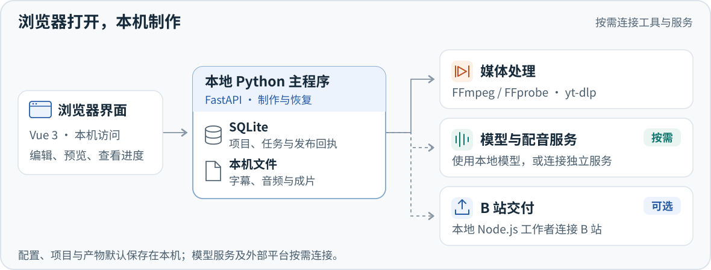

<div align="center">

<h1>DubForge</h1>

<p><strong>把视频翻译、字幕校对、配音和成片，放进同一个工作台。</strong></p>
<p>从一段短片开始，逐句打磨；再用模板，把同一套制作方式复用到更多视频。</p>

<p>
  <a href="#快速开始">开始使用</a> ·
  <a href="#学习路线">使用教学</a> ·
  <a href="#技术路线">了解实现</a> ·
  <a href="docs/README.md">全部文档</a>
</p>

</div>

DubForge 是运行在本机的视频译制工作台：输入视频链接或本地文件，按需生成双语字幕、配音和成片。你可以逐句校对，也可以复用模板批量制作；需要投稿时，再连接 B 站交付。

> **[v1.0.0 正式版](https://github.com/heroliss/dubforge/releases/tag/v1.0.0)** · Windows 源码发行 · 浏览器访问本地工作台

## 一条视频，按你的目标制作

输入视频链接或本地文件，从校对稿逐步得到成片。自动流程按目标计算依赖，也可以进入任一步骤检查和调整。


| 从这里开始 | 再进一步 |
| --- | --- |
| **一份校对稿**：对照视频修改原文、译文和时间 | 逐句试听、保留原声或选择配音，修改后只更新受影响的声音 |
| **一个成片版本**：组合声音、字幕和上屏评论 | 保留多个版本，分别管理参数、剪辑清单和输出 |
| **一个短片项目**：先试少量，再制作整片 | 保存模板，选择多个项目检查并批量运行 |

## 学习路线

先走通短片，再学习手动精修与自动制作。每章都有对应界面、观察重点和操作顺序，可以按经验跳读。

| 从浅到深 | 这一章解决什么问题 |
| --- | --- |
| **[1. 第一条视频](docs/tutorials/first-video.md)** | 最少需要准备什么，怎样做出一段原声字幕短片 |
| **[2. 手动制作与逐步检查](docs/tutorials/manual-workflow.md)** | 每个阶段接收什么、怎样运行、在哪里查看结果 |
| **[3. 自动流程、模板与批量](docs/tutorials/automation-and-templates.md)** | 怎样从一个项目自动推进，扩展到多个项目与合集顺序 |
| **[4. 设置怎么选](docs/tutorials/settings.md)** | 服务连接、制作效果、作用范围和存储分别在哪里调整 |

想先了解整套概念，打开[教学目录](docs/tutorials/README.md)；已经装好程序，可以直接开始第 1 章。

## 快速开始

### 1. 安装常用能力

先准备 [Git](https://git-scm.com/downloads)、[uv](https://docs.astral.sh/uv/getting-started/installation/)、[Node.js 24 LTS](https://nodejs.org/) 和 [FFmpeg](https://ffmpeg.org/download.html)（建议 7.1 或更新版）。`ffmpeg`、`ffprobe` 需能在终端中运行；Python 3.13 由 uv 准备。

在 **PowerShell** 中执行，安装主程序、本地识别与音轨分离：

```powershell
git clone https://github.com/heroliss/dubforge.git
cd dubforge
git checkout v1.0.0
powershell -NoProfile -ExecutionPolicy Bypass -File .\scripts\install.ps1 -Asr -Separation
```

下载[发行版源码压缩包](https://github.com/heroliss/dubforge/releases/latest)的用户，解压后在项目目录执行最后一行即可。私有仓库的源码与发行版需要已有仓库权限。

<details>
<summary>按需安装：只做字幕、增加投稿，或已有配音服务</summary>

安装选项可以组合，已有配置不会被覆盖：

| 能力 | 安装参数 | 还需准备 |
| --- | --- | --- |
| 基础程序 | 不带选项 | LLM 连接；按需使用已有字幕 |
| 本地语音识别 | `-Asr` | 首次执行时下载识别模型 |
| 人声与背景音分离 | `-Separation` | 分离模型；只提取音轨时可关闭分离 |
| B 站发布组件 | `-Publishing` | 安装后在工作台连接账号 |

**配音服务独立安装。** 使用配音时，按各自官方说明准备 IndexTTS 2.5 或 GPT-SoVITS，再在 DubForge 中填写地址与音色参数；安装脚本不包含这些服务或全部模型。

识别与分离依赖体积较大。GPU、缓存位置、已有服务和补装命令见[安装指南](docs/installation.md)。

</details>

### 2. 启动并打开网页

在项目目录执行：

```powershell
uv run --project backend --no-sync uvicorn app.main:app --host 127.0.0.1 --port 8600 --loop app.event_loop:create_event_loop
```

保持这个终端运行，在浏览器打开 **[http://127.0.0.1:8600](http://127.0.0.1:8600/)**。后端同时托管安装时构建好的网页。

<details>
<summary>需要开发模式或统一控制台？</summary>

运行 `StartDev.bat`，可按配置启动后端与 Vite，通过控制台查看状态、日志和管理服务。默认前端入口为 [http://127.0.0.1:5273](http://127.0.0.1:5273/)；端口及操作说明见[开发指南](docs/development.md)。

</details>

### 3. 跟着教学完成第一段

先连接 LLM，用一段短视频完成原声字幕版，再逐步加入配音、评论和投稿。第一次无需建立复杂模板。

**[开始第 1 章：第一条视频](docs/tutorials/first-video.md)**，按“准备 → 创建 → 确认目标 → 校对 → 试片”操作。

## 在工作台里完成制作

### 逐句打磨文字与声音

下面三处围绕同一份校对稿：对照原片、选择句子与声源、编辑文字和时间。


**① 对照原片 → ② 选择句子与声源 → ③ 编辑文字和时间**

先试听代表句，再批量补齐配音；同一项目可以组合多个成片版本，分别管理字幕、评论与剪辑。详细步骤见[手动制作教学](docs/tutorials/manual-workflow.md)。

### 从模板扩展到批量制作

先将已经调好的方案保存为模板，再回到项目空间。图中①指定模板，②选择本次项目，③检查计划后批量运行。


**① 指定模板 → ② 勾选项目 → ③ 检查并确认批量运行**

同一目标合集按确认顺序推进，其他分组独立运行；一组需要处理时，其他组可以继续。目标、分 P 顺序、模板应用与恢复见[自动流程教学](docs/tutorials/automation-and-templates.md)，批量创建清单见[JSON 导入说明](docs/batch-project-import.md)。

## 技术路线

DubForge 独立开发、独立运行。界面、任务状态和媒体处理在本机协作；模型服务与平台连接按所选目标启用。



<details>
<summary>展开技术栈与九阶段流程</summary>

| 部分 | 方案 |
| --- | --- |
| 界面 | Vue 3、TypeScript、Naive UI、Pinia |
| 应用与状态 | Python 3.13、FastAPI、SQLModel／SQLite；领域逻辑独立于 HTTP 层 |
| 视频与字幕 | yt-dlp、FFmpeg／FFprobe |
| 识别与分离 | faster-whisper、可选 Demucs |
| 语义整理与翻译 | OpenAI 兼容 LLM，可配置服务与故障回退 |
| 配音 | 独立 IndexTTS 2.5 或 GPT-SoVITS 服务 |
| B 站连接 | 独立 Node.js 工作者，使用 @renmu/bili-api |
| 恢复与复用 | 原子写入、输入指纹、冻结快照、后台任务与持久回执 |

界面按九个阶段组织：

```text
获取视频 → 音轨分离 → 语音转文字 → 语义整理 → 翻译
                                           ↓
发布到 B 站 ← 合成成片 ← 上屏评论 ← 字幕与配音
```

实际执行计划按目标解析依赖，**不要求每个项目运行全部九步**。模块边界、数据流与状态设计见[架构说明](docs/architecture.md)。

</details>

## 继续阅读

| 现在想做什么 | 从这里进入 |
| --- | --- |
| 安装、连接模型，或解决运行问题 | [安装指南](docs/installation.md) · [故障排查](docs/troubleshooting.md) |
| 按主题学习实际操作 | [第一条视频](docs/tutorials/first-video.md) · [手动步骤](docs/tutorials/manual-workflow.md) · [自动流程](docs/tutorials/automation-and-templates.md) · [设置说明](docs/tutorials/settings.md) |
| 批量创建项目、复用制作规则 | [批量导入](docs/batch-project-import.md) · 应用内「使用帮助」 |
| 理解源码、参与开发和维护 | [架构说明](docs/architecture.md) · [开发指南](docs/development.md) · [贡献指南](CONTRIBUTING.md) |
| 查看版本、验证与发行方式 | [变更记录](CHANGELOG.md) · [v1.0.0 验证记录](docs/validation-v1.0.0.md) · [发行流程](docs/releasing.md) |

完整导航与历史设计依据见[文档索引](docs/README.md)。

<details>
<summary>截图、数据与许可说明</summary>

- **真实界面截图**来自隔离演示项目，使用自写双语稿和自绘视频，不含真实账号、密钥或私有作品；不代表已完成真实模型或平台交付。首页与教学各章按内容复用配图，原图和圈线复现方法见[截图工具说明](scripts/docs/README.md)。两张流程／架构图是说明性示意图。
- **源码发行不包含**模型、配音服务、账号凭据和视频产物。升级前保留自己的配置与工作目录，先阅读变更记录。
- **仓库保持私有，尚未指定开源许可证。** 第三方组件与模型遵循各自的许可证及使用条款，见[第三方说明](THIRD_PARTY.md)。

</details>
