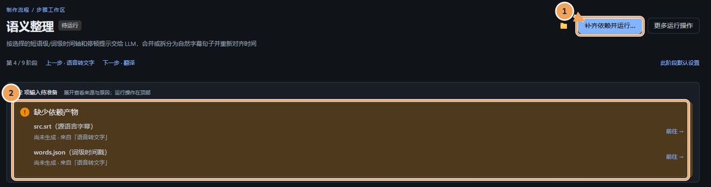
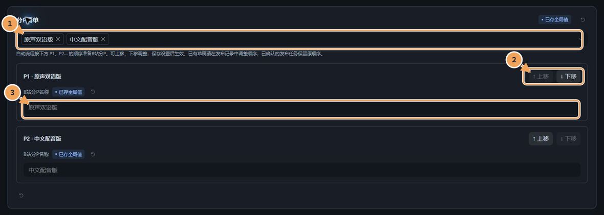

# 手动制作：逐步看懂一个项目

已经按[快速开始](../../README.md#快速开始)做过一段短片后，可以用本篇了解每个阶段接收什么、在哪里调整，以及哪些结果能够复用。

**手动制作与自动运行使用同一个项目、同一份校对稿和成片版本。** 手动运行适合逐步检查与精修；自动运行按已确认的目标准备依赖、衔接后续工作，不需要另建项目。

## 开始前，先看目标和状态

- **九个阶段是工作区导航。** 「上屏评论」是可选工作区，「发布到B站」是独立交付流程；本地制作不要求执行它们。
- **先保存，再运行。** 常规步骤顶部提供「运行本步」或「重新运行本步」；缺少依赖时，先查看待准备输入及检查方案，再确认。自动流程执行期间，单步重跑会受保护。
- **先看有效性，再决定重做。** 「已是最新」可以复用；「本步设置已改」「上游产物已变」需要核对影响范围。「产物核验中」表示仍在确认结果，等待核验完成即可，不要重复启动。

**① 找运行入口，② 看输入是否齐全。** 图中演示项目的上游尚未运行，因此显示依赖提示和「补齐依赖并运行…」；先检查补齐方案，再确认执行。

## 1. 从素材得到可校对的文稿

前五个阶段解决素材、原文、分句和译文。第一次保持默认参数，重点检查每一步的预览，而不是一次修改所有选项。

| 阶段与输入 | 在页面做什么 | 检查什么 | 何时可省去处理或复用 |
| --- | --- | --- | --- |
| **① 获取视频**：视频链接或本地文件 | 选择下载参数并运行；本地文件使用已登记的来源 | 播放源视频，确认时长、画面与视频资料 | 有效素材直接复用；本地导入不需要网络下载 |
| **② 音轨分离**：源视频 | 决定是否分离人声与背景，再保存运行 | 切换原始音轨、人声、背景音试听 | 关闭分离仍可提取识别所需音轨；是否需要独立人声和背景，取决于后续参考音色与混音目标 |
| **③ 语音转文字**：识别音轨，或已确认导入的平台字幕 | 选择「原文获取方式」并运行 | 对照视频检查短语级识别原稿，关注漏字、语言和时间 | 选择「已导入的平台字幕」时不运行语音识别，仍需运行本步形成制作原稿；原输入未变化时复用有效结果 |
| **④ 语义整理**：原稿与时间轴 | 保存整理设置，运行后查看自然分句 | 句意是否完整，边界是否自然，真实停顿是否保留 | 关闭 LLM 后仍使用本地规则整理；已有有效整理稿可复用，不必因查看页面而重做 |
| **⑤ 翻译**：整理后的原文 | 按需补充术语、风格和背景资料，保存后运行 | 对照原文检查译文、术语与逐句对应 | 仅导出原文字幕时不要求翻译；其他目标按实际消费的译文准备依赖 |

**看到平台列出了字幕语言，不等于已经选用字幕。** 平台字幕需先明确导入，核对语言及分 P 时间轴，再在第③步选择该来源；切换来源会影响依赖它的下游内容。

语义整理和翻译页可以切换到「LLM 对话」，核对发送素材和模型结果；遇到失败，先看错误说明与「运行日志」。有效结果由输入及设置共同决定，不以文件是否存在判断。

## 2. 精修文字、时间与声音

### ⑥ 字幕与配音：先校对，再试听

**输入：** 已有原文稿；双语字幕和目标语言配音还需要译文。先对照视频找几句有代表性的对白，检查文字、时间，再决定使用原声还是配音。

下图重点看播放器、句子列表和文字编辑入口；三处操作围绕同一份校对稿展开。

**① 对照原片 → ② 选择句子与声源 → ③ 编辑文字和时间。** 列表勾选控制本次操作范围，原声／配音选择决定成片使用的声音，两者用途不同。

| 想得到什么 | 操作与检查 | 可以省去什么 |
| --- | --- | --- |
| **校对后的字幕文件** | 点击「编辑文字与时间」修订并保存；到「字幕工作区」选择导出类型，再「仅导出字幕文件」 | 不生成配音或视频；仅导出原文时无需译文 |
| **烧进画面的字幕** | 在「字幕工作区」调整样式并预览一帧，保存字幕设置；随后在成片版本中开启字幕烧录 | 不要求先单独导出 SRT；一帧预览不会生成正式视频 |
| **目标语言配音** | 保存所用服务、音色与参数，勾选代表句「生成勾选配音」并试听；满意后「补齐未完成配音」 | 有效声音继续复用；选择原声的句子不必为了配音版全部重做 |

SRT 只保存文字与时间，不保存字体、颜色等样式。字幕、试听和成片读取同一份已保存校对稿；修改文字、时间或音色后，按页面提示更新受影响的声音。

**试听满意后还要看声源。** 「标记满意」用于记录对当前声音版本的判断，不等于选用该声音。播放器监听音量与「仅听人声」只影响本机试听；人声和背景是否协调，最后用成片试片检查。

## 3. 按需加入评论，组合与剪辑成片

### ⑦ 上屏评论：可选的画面内容

只想得到字幕或普通配音成片时，可以跳过整个评论工作区。需要观众评论出现在画面中时，再按下面的顺序准备：

| 输入 | 在页面做什么 | 检查结果 | 如何复用 |
| --- | --- | --- | --- |
| 已有评论正文，可按需「获取热门评论」 | 设置「目标数量」并「准备目标数量评论」；核对入选文字、顺序、时间和样式，再「确认上屏方案」 | 预览显示位置、停留时间和文字是否合适 | 已完成的评分和译文可复用，只补缺项；确认方案不会自动生成视频 |

最后还需在要制作的成片版本中开启评论。仅原声加评论的版本，不会因此要求生成对话配音；不同版本可以分别决定是否使用评论。

### ⑧ 合成成片：分清目标、手动范围和正式结果

**输入：** 源视频，以及当前版本实际启用的声音、字幕、评论和剪辑设置。版本需要什么才检查什么；例如原声版不为未使用的配音补齐整套声音。

下图把三种范围分开：项目长期要交付的版本、本次手动要生成的版本，以及当前版本自己的剪辑清单。

**① 项目目标成片**用于总览和批量运行；**② 手动勾选**只决定本次生成哪些版本；**③ 剪辑清单**随当前版本保存。手动勾选不会改写项目目标，也不会重做全部历史版本。

1. **选择并保存版本。** 分别设置声音、字幕和评论；需要比较两种效果时复制为新版本，给它们起容易识别的名称。
2. **先生成短试片。** 检查字幕位置、音色、人声与背景比例，以及评论和画面的遮挡。试片独立于正式输出，成功不表示整片已更新。
3. **检查删除片段。** 在「成片剪辑」按原片时间标记起止点；「加入并预览」或「预览剪辑效果」可使用当前草稿。确认后保存清单，供正式生成使用。
4. **生成并核对正式版本。** 保存版本设置，勾选本次范围，检查确认后生成。完成后播放对应正式成片，检查声音报告与结果是否仍有待更新提示。

完整的起止标记会在预览或保存时一并收录；未完成的标记需补齐或清除。保存剪辑清单不会立即改变已有视频：重新生成当前版本后才应用，源视频、原稿及逐句配音保持原时间轴，章节按对应成片的剪辑快照换算。

**有效版本可复用，变化版本只替换自身。** 失败或取消保留原有效成片；已经生成的成片也可用「基于当前成片生成剪辑版」另建独立版本，保留原版本。新旧结果以实际生成与核验状态区分。

## 4. 有需要时，再交付到 B 站

### ⑨ 发布到B站：先准备稿件，再确认外部操作

本地制作到此可以结束。需要投稿时，先安装发布组件并连接自己的账号；这些准备见[安装指南](../installation.md)。

**输入：** 准备交付的成片版本，以及账号、分 P、封面、文案和合集等稿件资料。

1. **选择稿件目标。** 新项目默认准备新稿；已有发布记录时，明确选择新稿或要更新的原稿。回执不明时先核对原操作。
2. **整理视频清单。** 为每个分 P 选用成片并调整顺序，核对文件有效性、分 P 名称和数量；顺序以这份清单为准。
3. **保存投稿资料。** 检查账号、封面、标题、简介及其他声明，点击「保存资料」。保存到本地草稿不会开始上传。
4. **检查并确认发布方式。** 「上传并投稿」确认后衔接上传和投稿；只想先传文件时，在「其他发布方式」选择「仅上传文件」，之后仍需单独确认投稿。

**① 选版本 → ② 排顺序 → ③ 起名称。** 这里保存项目自动流程使用的分 P 清单；已有本地稿件还需在发布记录中调整对应清单，已确认的发布任务保留确认时的顺序。

| 看见的状态 | 还要检查什么 |
| --- | --- |
| 文件已上传 | 是否仍停在待投稿，稿件资料是否已提交 |
| 已取得 BV | 转码、审核与公开状态，不能仅凭 BV 判断已公开 |
| 合集或章节待处理 | 各自的任务与原因；章节失败只重试未完成章节，不必再次投稿视频 |
| 审核退回或回执不明 | 查看原稿原因与已有回执，先处理原操作，避免新建重复稿件 |

关闭网页不会停止后台交付，关闭后端则可能中断任务。遇到失败时使用原任务的恢复入口，并核对结果；不要通过重复新建稿件绕开未知回执。

## 下一步

- 想把已验证的制作方式用于更多视频：阅读[自动运行与模板](automation-and-templates.md)。
- 遇到依赖、模型、进度或恢复问题：阅读[故障排查](../troubleshooting.md)；理解设计边界可看[架构说明](../architecture.md)。

本篇界面图来自隔离演示项目，用于识别页面与操作位置；不代表已经执行真实模型推理或平台投稿。
