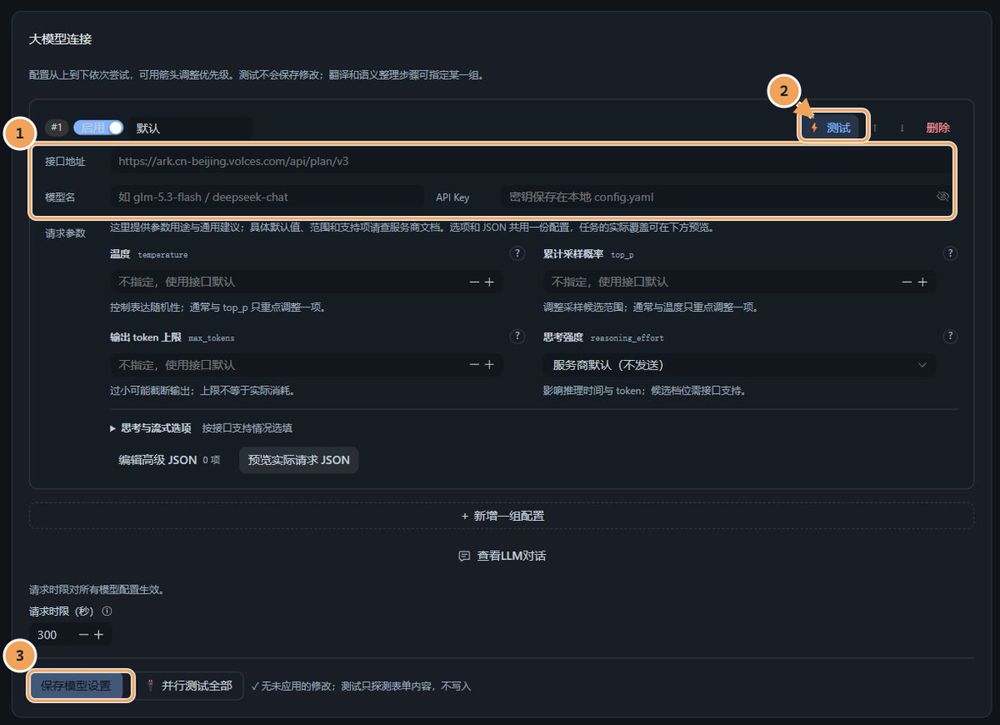
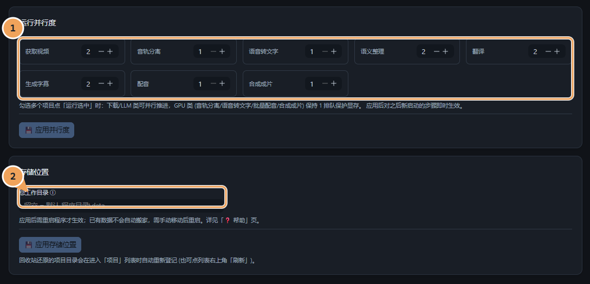

# 设置怎么选：按想调整的事情查找

[教学目录](README.md) · 上一章：[自动流程、模板与批量](automation-and-templates.md)

设置先分两件事：**程序怎样连接工具与服务**，以及**你想做出什么效果**。第一次只配置必需连接，其余先用默认值，看到具体问题后再调整。

## 先找对入口

| 想调整什么 | 去哪里 |
|---|---|
| 翻译、语义整理调用哪个模型 | 设置 → 模型与服务 |
| 字幕、配音、成片和交付的通用规则 | 设置 → 制作与发布 → 全局默认或系列模板 |
| 只改变某个视频的处理方式 | 项目对应步骤页 |
| 只改变一个成片版本或一句话 | 成片版本设置或本句设置 |
| 连接 B 站账号 | 设置 → B站账号；具体稿件目标在项目发布页确认 |
| 并行任务、显示偏好与总工作目录 | 设置 → 运行与存储 |

## 模型与配音服务

### 连接 LLM：先确认能调用，再调生成参数

进入「模型与服务」，先填写接口地址、模型名和 API Key。服务商的模型名和地址以自己实际开通的接口为准，截图中的灰字是占位提示。

**① 填写连接信息 → ② 测试连接 → ③ 保存模型设置**

测试只探测当前表单，不替你保存；保存后才用于之后的调用。多个启用配置按顺序尝试，语义整理和翻译也可以明确指定某一组。

温度、输出 token 上限、思考强度等参数先不填，使用接口默认；确定服务商支持相应参数后再调整。语义整理和翻译若选择低思考强度，会按步骤覆盖相应参数，以请求预览为准。换模型不会自动重做已有结果，想比较新模型时，在相应步骤主动重新生成。

### 连接配音：服务、音色和排布分别检查

在「制作与发布 → 字幕与配音」配置全局默认，或在项目配音页设置本次使用的服务。IndexTTS / GPT-SoVITS 有自己的安装环境和模型，不与 DubForge 主程序混装。

| 问题 | 先检查 |
|---|---|
| 服务连不上 | 地址、端口、服务日志；本机路径是否填写正确 |
| 能连接但合成失败 | 模型与参考音频、所选音色及服务端错误 |
| 能合成但语速或时间不合适 | 先试听代表句，再看配音时间排布与超长处理 |
| 成片人声被背景盖住 | 在合成设置调整人声／背景比例，用短试片判断 |

具体安装与启动方法见[配音服务安装说明](../installation.md#可选配音服务)。只导出字幕或制作原声版时不需要启动配音服务。

## 设置的作用范围

| 层级 | 用在什么地方 | 修改后会怎样 |
|---|---|---|
| 全局默认 | 新项目的通用制作规则 | 已有项目保留基础值，需要时主动应用最新设置 |
| 系列模板 | 一类视频共用的语言、声音、版本与交付规则 | 先保存模板，再比较差异并应用到已有项目 |
| 项目设置 | 当前视频的例外 | 保留项目的单独选择，不被模板更新悄悄覆盖 |
| 成片版本／本句设置 | 特定版本或某一句的精调 | 在相应范围优先使用，不必改变其他版本或句子 |

配置来源标识告诉你值来自哪里；回转箭头的提示说明恢复到哪一层。恢复先改变当前草稿，仍需点击所在表单的保存或确认按钮。

制作任务执行时使用已确认输入；当前执行范围涉及的参数会受保护，未涉及或仍在排队的设置按界面提示编辑。模板不会在任务中途悄悄改动正在执行的工作。

## 遇到效果问题，优先改什么

| 看到的问题 | 先做的小调整 |
|---|---|
| 识别错误多 | 核对源语言、原片人声与识别模型；不要先去改翻译提示 |
| 断句太碎、时间不自然 | 查看语义整理结果与时间边界，再校对具体句子 |
| 译文含义不准 | 对照原文与上下文，局部改译；需要时再换翻译模型 |
| 字幕太挤或看不清 | 在字幕设置检查字号、描边、底色及预览，不先重做声音 |
| 配音句子偏长 | 先听该句内容与语速，再看排布和超长处理 |
| 背景太吵、不同视频音量差异大 | 先调人声与背景比例，再按需要统一最终响度 |
| 成片体积太大 | 在合成设置调整编码质量，先比较短试片 |

每次只改影响当前问题的少量设置，再试听或试片；确定有效后再保存到模板复用。

## 运行与存储

并行度决定同时进行多少任务，不保证越高越快。遇到内存、显存不足或接口限流，先减少相应并行任务，观察实际资源和错误。

**① 控制同时运行的任务 → ② 确认项目与缓存保存位置**

留空总工作目录时，使用程序默认位置。更换工作目录先按[备份与迁移说明](../development.md#备份升级与迁移)安排：保留配置、完整工作目录及外部源文件，待任务安全结束后再迁移并重启。只修改路径不会替你搬好所有文件。

模型缓存与项目产物是不同内容，缓存位置可按[安装指南](../installation.md#模型缓存与工作目录)通过明确配置指定；不要把模型、音频或回执当作普通临时缓存随意删除。

[返回教学目录](README.md) · [回看自动流程与模板](automation-and-templates.md) · [故障排查](../troubleshooting.md)
